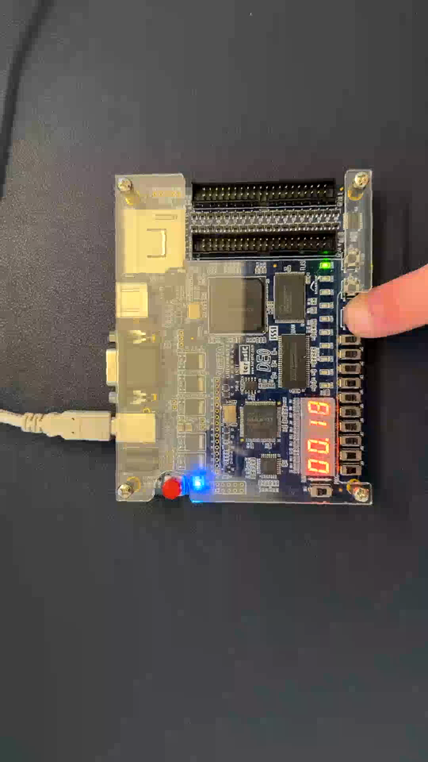

# FPGA Reaction-Time Meter

A reaction-time game implemented for the DE0 FPGA board as a Digital Systems Laboratory final project. The design combines a SystemVerilog controller with Quartus II schematic blocks. It uses the board's push buttons, LEDs, switches, and four seven-segment displays.

## How it works

1. Press **KEY0** to start the countdown.
2. After the countdown, the controller waits for a delay based on a free-running counter. Pressing the reaction button early produces a false-start indication.
3. When the LEDs signal the start, press **KEY2** as quickly as possible. The displays show the measured reaction time.
4. Use the switches to view the best result, the last result, or the average. A new best result triggers an LED animation.

The controller uses a finite-state machine for startup, idle, countdown, wait, measurement, result, false start, and celebration. The stopwatch, display, and other logic are connected in the top-level schematic, `quartus/main.bdf`.

## Board controls

| Control | Function |
| --- | --- |
| KEY0 | Start a measurement |
| KEY2 | Stop the measurement after the start signal |
| SW9 | Active-low system reset (`reset_n`); leave high for normal operation |
| SW0 | Select best result |
| SW1 | Select last result |
| SW2 | Select average result |

The project uses the DE0's 50 MHz clock, ten green LEDs, and four seven-segment displays. Physical pin assignments are in `quartus/de0_pins.tcl` and `quartus/modulo60-counter.qsf`.

## Project files and setup

The supplied project metadata names **Quartus II 9.1 SP2**, an **Altera Cyclone III EP3C16F484C6**, and `main` as the top-level entity. The original project filename is `modulo60-counter.qpf`; it is retained so its revision and file references remain intact. A machine-specific path to the included `modulo60-counter.dpf` file was changed to a relative path for portability.

1. Obtain a Quartus II installation that supports the Cyclone III device and the DE0 board.
2. Open `quartus/modulo60-counter.qpf` in Quartus II. Keep the contents of the `quartus` directory together: the project references schematic, HDL, IP, and pin files by relative filename.
3. Confirm that the selected top-level entity is `main`, then compile the project.
4. If compilation succeeds, program the DE0 with the resulting programming file and use the controls above.

The archived project contains the design and its referenced source files, but it does **not** include a compiled `.sof` programming file. The archived hardware demonstration is shown below. Compilation and programming from this GitHub package have not been rechecked in the author's Quartus installation.

## Demonstration

https://github.com/user-attachments/assets/361503cd-4af8-4530-9998-1b4aace05b54

## Verification scope

The Quartus archive was inspected and all files named by the project's HDL, schematic, IP, and pin-script assignments are present. The original submission includes waveform files for individual lab blocks; these are **not** a testbench for the complete reaction-time system. No full-system simulation or automated hardware tests are claimed here.

## Scope and provenance

This is an academic hardware project, not a commercial reaction-time instrument. The stopwatch block originated in an earlier laboratory exercise and was extended for this project. Some `lpm_*` files were generated by Altera's Quartus tools. The repository keeps the original design files and documents their original project name rather than presenting those tool-generated components as handwritten HDL.

Project and demonstration by Eliad Levy, Electrical and Electronics Engineering student at Ruppin Academic Center.
